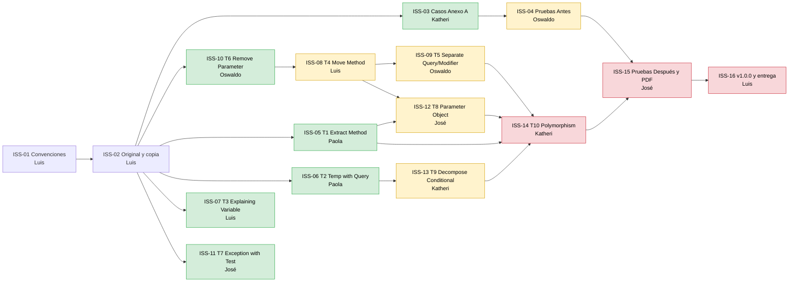

# Planeación — ADA 4 · Refactorización del gestor de préstamos

**Entrega:** antes del jueves 12/11/2026 → cierre interno **miércoles 11/11 a las 23:59**.

---

## 1. Issues y responsables

| Issue | Título | Responsable | Milestone | ⛔ No empieza hasta que se fusione | Desbloquea a |
|---|---|---|---|---|---|
| ISS-01 | Convenciones, ramas y tablero | Luis | Línea base | — | — |
| ISS-02 | Proyecto original y copia de trabajo | Luis | Línea base | ISS-01 | ISS-03, 05, 06, 07, 10, 11 |
| ISS-03 | Casos de prueba del Anexo A | Katheri | Línea base | ISS-02 | ISS-04 |
| ISS-04 | Anexo A sobre el original (*Antes*) | Oswaldo | Línea base | **ISS-03** | ISS-15 |
| ISS-05 | T1 · Extract Method | Paola | Refactorización | ISS-02 | ISS-12, ISS-14 |
| ISS-06 | T2 · Replace Temp with Query | Paola | Refactorización | ISS-02 | ISS-13 |
| ISS-07 | T3 · Introduce Explaining Variable | Luis | Refactorización | ISS-02 | — |
| ISS-08 | T4 · Move Method | Luis | Refactorización | **ISS-10** | ISS-09, ISS-12 |
| ISS-09 | T5 · Separate Query from Modifier | Oswaldo | Refactorización | **ISS-08** | ISS-14 |
| ISS-10 | T6 · Remove Parameter | Oswaldo | Refactorización | ISS-02 | ISS-08 |
| ISS-11 | T7 · Replace Exception with Test | José | Refactorización | ISS-02 | — |
| ISS-12 | T8 · Introduce Parameter Object | José | Refactorización | **ISS-05 y ISS-08** | ISS-14 |
| ISS-13 | T9 · Decompose Conditional | Katheri | Refactorización | **ISS-06** | ISS-14 |
| ISS-14 | T10 · Replace Conditional with Polymorphism | Katheri | Refactorización | **ISS-05, 09, 12 y 13** | ISS-15 |
| ISS-15 | Anexo A sobre el refactorizado (*Después*) y PDF | José | Entrega | **ISS-04 y ISS-14** | ISS-16 |
| ISS-16 | Integrar, `v1.0.0` y entregar | Luis | Entrega | **ISS-15** | — |

Para **validar** cualquier técnica (correr el Anexo A) se necesitan los casos de ISS-03. Puedes empezar a refactorizar antes, pero no abras el PR sin haber corrido las pruebas.

---

**Tabla de verificación de las pruebas de caja negra:** José verifica el Anexo A sobre el proyecto refactorizado (columna *Después*) y genera el PDF en ISS-15. La columna *Antes* (ISS-04) la registra Oswaldo sobre el original.

---

## 2. Dependencias

> [!CAUTION]
> **Una flecha `A → B` significa: B no se empieza hasta que A esté fusionado en `develop`.**
> Si empiezas antes, tu rama va a chocar con el cambio de A y vas a tener que rehacer trabajo.
> Cuando fusiones tu PR, **avisa en los issues que desbloqueas** (comentario con `@` a su responsable).

🟩 **Se pueden empezar ya:** ISS-03, ISS-05, ISS-06, ISS-07, ISS-10 e ISS-11.
🟨 **Esperan a otro issue:** ISS-04, ISS-08, ISS-09, ISS-12 e ISS-13.
🟥 **Van al final:** ISS-14, ISS-15 e ISS-16.

### Por qué existe cada dependencia

| Dependencia | Motivo |
|---|---|
| ISS-10 (T6) → ISS-08 (T4) | Hoy `registrarDevolucion()` recibe `penalizacionPorDia` y no lo usa. Si T4 mueve antes el cálculo a `Prestamo`, ese parámetro empieza a usarse y T6 ya no se puede aplicar. |
| ISS-08 (T4) → ISS-09 (T5) | Las dos cambian `GestorPrestamos.devolver()`. T5 separa consulta y modificador del método **ya limpio**. |
| ISS-05 (T1) → ISS-12 (T8) | Las dos cambian `MenuConsola.prestar()`. T8 cambia el método de fechas que extrae T1. |
| ISS-08 (T4) → ISS-12 (T8) | Las dos cambian `Prestamo`. T8 cambia el constructor y T4 la devolución; en orden no chocan. |
| ISS-06 (T2) → ISS-13 (T9) | Las dos cambian `verPrestamosActivos()`. Sin la variable `hoy` (T2), los métodos que extrae T9 no necesitan recibirla. |
| ISS-05, 09, 12, 13 → ISS-14 (T10) | T10 reorganiza todo `MenuConsola`. Si va antes, todos los PR que tocan el menú chocan con ella. |
| ISS-14 → ISS-15 | Las pruebas *Después* se corren sobre el proyecto con las diez técnicas. |

---

## 3. Calendario

| Cuándo | Qué | Quién |
|---|---|---|
| **Lun 9/11 noche** | Aceptar la invitación, clonar y comentar `java -version` en ISS-01 | Todos |
| **Lun 9/11 noche** | ISS-03 casos del Anexo A | Katheri |
| **Lun 9/11 noche** | ISS-10 (T6), cambio corto que libera la cadena | Oswaldo |
| **Mar 10/11 10:00** | ISS-04 línea base fusionada · **cierre milestone Línea base** | Oswaldo |
| **Mar 10/11 mañana** | ISS-05 (T1), ISS-06 (T2), ISS-07 (T3) e ISS-11 (T7) | Paola, Luis, José |
| **Mar 10/11 mediodía** | ISS-08 (T4), en cuanto se fusione ISS-10 | Luis |
| **Mar 10/11 tarde** | ISS-09 (T5) en cuanto se fusione ISS-08, e ISS-13 (T9) en cuanto se fusione ISS-06 | Oswaldo, Katheri |
| **Mar 10/11 noche** | ISS-12 (T8), en cuanto se fusionen ISS-05 e ISS-08 | José |
| **Mié 11/11 14:00** | ISS-14 (T10) fusionada · **cierre milestone Refactorización** | Katheri |
| **Mié 11/11 tarde** | ISS-15 pruebas *Después* y PDF | José |
| **Mié 11/11 23:59** | ISS-16 `v1.0.0` y entrega en la plataforma · **cierre milestone Entrega** | Luis |

---

## 4. Tablero

Columnas del tablero de GitHub Projects:

| Columna | Qué significa |
|---|---|
| **Bloqueado** | Tiene una dependencia sin fusionar. **No se empieza.** |
| **Por hacer** | Sus dependencias ya están fusionadas; se puede tomar |
| **En progreso** | Alguien ya trabaja en la rama |
| **En revisión** | PR abierto, esperando aprobación |
| **Hecho** | PR fusionado e issue cerrado |

Cuando se fusiona un issue, su responsable mueve a *Por hacer* los issues que desbloqueó y les quita el label `estado:bloqueado`.
